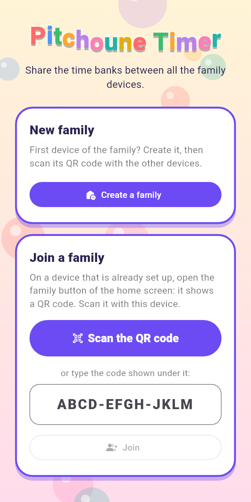
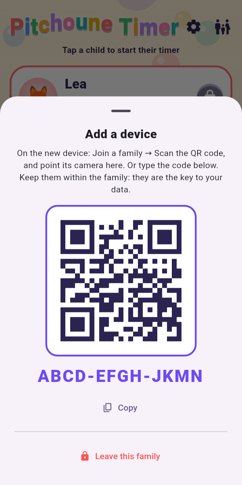
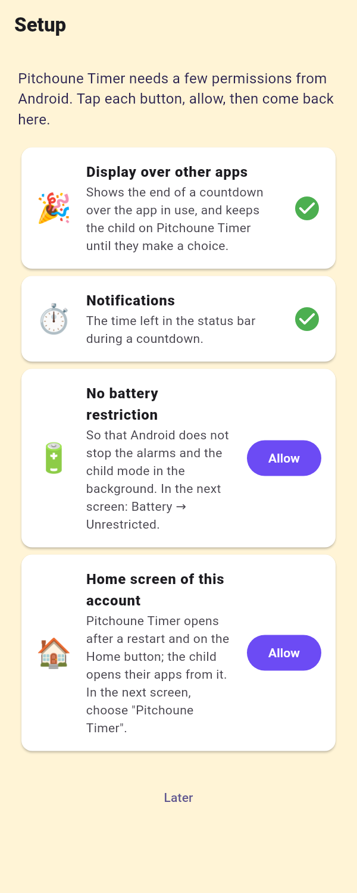
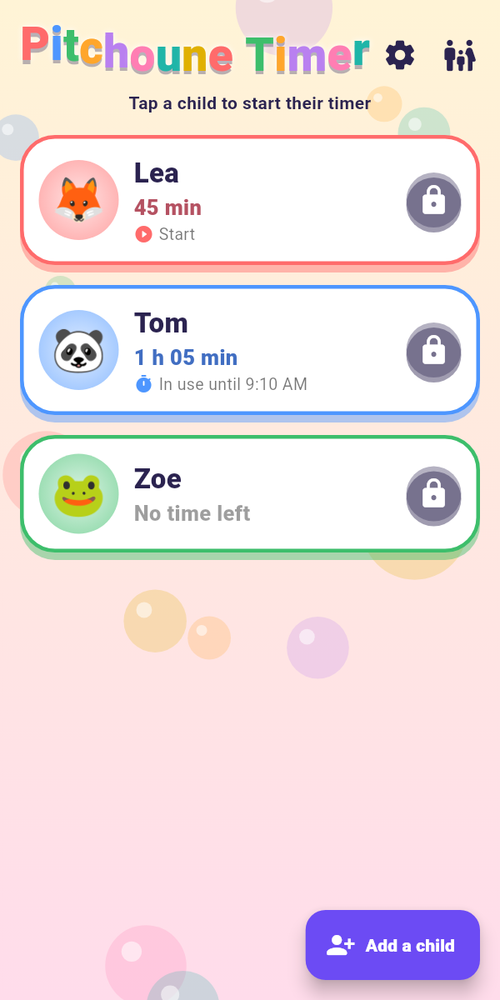
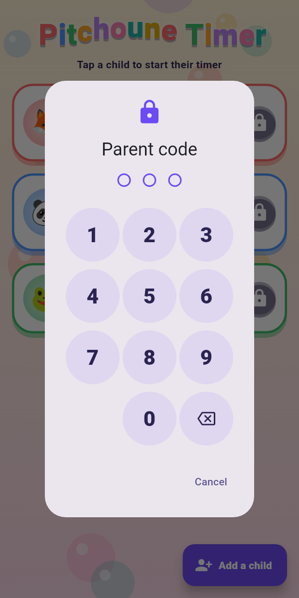
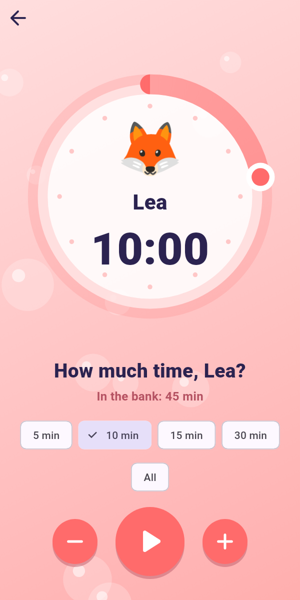
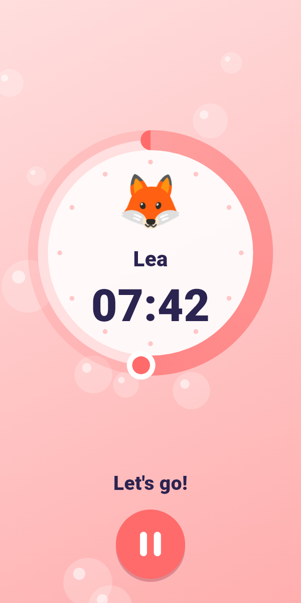
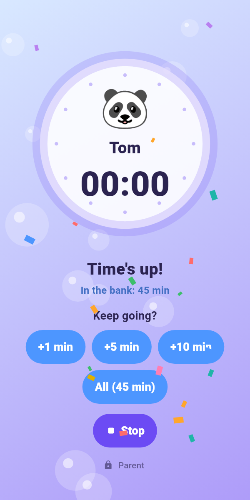
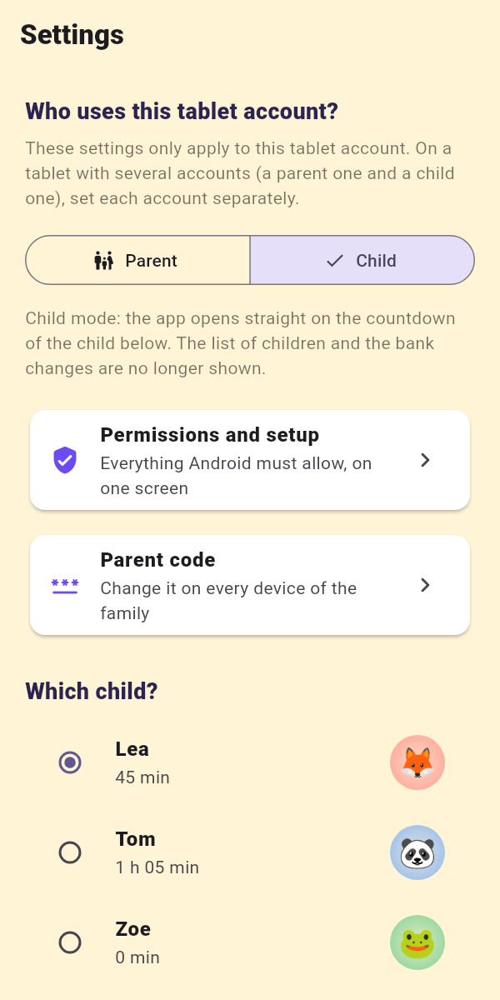

  

# Pitchoune Timer

**Screen time, managed like pocket money.**

Each child has a **time bank**. A parent puts minutes in it; the child decides
when to spend them and how many: they withdraw an amount, and a colourful
countdown starts. When time is up, Pitchoune Timer comes back to the front,
even over a game or a video, and the child chooses: take a little more from
the bank, or stop.

The banks are shared by every tablet and phone of the family: minutes given on
a parent's phone show up at once on the children's tablet.

> Pitchoune Timer is an Android app shared with family and friends.
> To install it, see the [installation guide](doc/INSTALL.md).
> **Developers:** everything is in the [architecture document](doc/ARCHITECTURE.md)
> (design, code, learning notes, and chapter 10 for setup, build and release).

---

## Contents

1. [The idea](#1-the-idea)
2. [First launch: create or join a family](#2-first-launch-create-or-join-a-family)
3. [Setup: what Android must allow](#3-setup-what-android-must-allow)
4. [For parents: children and minutes](#4-for-parents-children-and-minutes)
5. [For children: taking time](#5-for-children-taking-time)
6. [When time is up](#6-when-time-is-up)
7. [The child's own tablet account (child mode)](#7-the-childs-own-tablet-account-child-mode)
8. [Settings](#8-settings)
9. [Questions and problems](#9-questions-and-problems)

---

## 1. The idea

| | |
|---|---|
| 🏦 **A bank of minutes per child** | Parents add minutes (for a chore, on Saturday morning…) or remove some. |
| 🎯 **The child chooses** | 5 minutes now, 30 minutes later: they learn to manage their time. |
| ⏱️ **A visible countdown** | In the app, and in the status bar while they use another app. |
| 🔔 **A clear end** | The app comes back to the front and the child must choose: more time, or stop. |
| 👨‍👩‍👧 **Shared** | Every device of the family sees the same banks, live. No account to create. |
| 🔒 **Parent code** | Changing a bank and the settings need the parent code. |

A minute started is a minute used: the bank always shows whole minutes
("12 min", "1 h 05 min").

---

## 2. First launch: create or join a family

A **family** links the devices that share the same children and banks.

  
  
  

- **First device** (a parent's phone or tablet): **Create a family**.
- **Each other device**: on the first device, tap the **family button** of the
  home screen: it shows a QR code. On the new device, **Join a family → Scan
  the QR code**, allow the camera, and point it at the QR code. That's it.
- No camera, or a single tablet shared between a parent account and a child
  account? Type the 12-character code written under the QR code.

The family code is the key to your family's data: keep it within the family.
Leaving the family (family button → *Leave this family*) needs the parent code.

The first launch needs the internet; afterwards the app also works offline and
catches up when the connection comes back.

---

## 3. Setup: what Android must allow

As soon as the app starts, a **Setup** screen lists what Android must allow.
Tap **Allow** on each line, accept in the screen that opens, then come back:
the line gets a green ✓.

- **Display over other apps**: the end of a countdown shows up over the app in
  use, and the child cannot leave a paused or ended countdown.
- **Notifications**: the time left in the status bar.
- **No battery restriction**: Android does not stop the alarms in the
  background. In the screen that opens: *Battery → Unrestricted*.
- **Home screen of this account** (child mode only, see §7).

*Later* keeps the list for the next launch. It is always in ⚙ → *Permissions
and setup*.

 

---

## 4. For parents: children and minutes

  
  

- **Add a child**: the *Add a child* button, then a name and an animal. A new
  child starts with an empty bank.
- **Give or take minutes**: the − and + buttons of the child's card. Hold a
  button down to go faster. While parent mode is locked, the card shows a
  🔒 instead: tap it and type the **parent code**.
- **Parent mode** stays open **2 minutes** after the code (a banner shows it),
  then locks itself again.
- **Long press on a card**: edit the name or the animal, reset the bank to
  zero, or delete the child (the last two need the parent code).
- A card shows when the child's timer is **running on another device**: one
  child, one countdown at a time.

The parent code is **728** in this version.

---

## 5. For children: taking time

  
  
  

1. Tap your card (in child mode, your screen is already open).
2. **Choose how much**: 5, 10, 15 or 30 minutes, *All*, or adjust minute by
   minute with − and +. You cannot take more than your bank.
3. **Start**: the countdown begins. The minutes are taken from your bank as
   they pass.
4. Go and play: the **time left stays in the status bar**, next to the clock,
   in minutes, then in seconds during the last minute. Pull the notifications
   down to see the exact time.
5. **Pause** if you stop early: only the time used is taken (a minute started
   counts as used). From the pause, *Resume* or *Stop*.

The screen stays on while the countdown is shown in the app.

---

## 6. When time is up

The alarm rings and **Pitchoune Timer comes back to the front**, over the game
or the video, even if the tablet was locked. Confetti! Then the child must
choose:

- **+1 min, +5 min, +10 min** or **All**: a little more, taken from the bank.
  The app then hands the screen back to the game or the video.
- **Stop**: the countdown is over.
- With an **empty bank**, there is nothing more to take: "The bank is empty.
  Ask a parent for more time!"

Until the child chooses, they **stay on this screen**: going to another app
shows a full screen window that brings them back. A parent can leave with the
discreet *Parent* button and the code.

 

---

## 7. The child's own tablet account (child mode)

On a tablet with a **user account for the child** (Android *users* or
*restricted profile*), Pitchoune Timer can become the child's home base.

  
  

Set it up **in the child's account**: open the app, join the family, then
⚙ (parent code) → **Child** → choose the child, and allow everything in the
Setup screen, including **Home screen of this account** (choose "Pitchoune
Timer").

Then:
- The app **opens straight on the child's screen**: no list of children, no
  bank changes.
- It is the **home screen** of the account: it shows after a restart, on the
  Home button, and at every unlock (unless a countdown is running).
- The child **stays on it until they start a countdown**. During the
  countdown, **My apps** (next to *Pause*) opens their apps. On a restricted
  profile, these are exactly the apps you allowed for it.
- When the countdown ends, they come back to it. With an empty bank, they
  stay there until a parent adds minutes.
- A discreet *Parent* button (code) lets an adult use the tablet: *Apps
  (parent)* then gives the list of apps.
- A quiet "child mode" notification shows that the app watches the unlocks.

Each Android account keeps its own settings: the parent account stays in
parent mode, with its usual home screen.

---

## 8. Settings

⚙ on the home screen (parent mode) or on the child's screen (child mode),
behind the parent code:

- **Who uses this tablet account?** *Parent* (every child, banks can be
  changed) or *Child* (one child, child mode).
- **Which child?** in child mode.
- **Permissions and setup**: the Setup screen.
- At the bottom, the **version** of the app, e.g. "1.0.0 (build 6)": useful
  to know which version a tablet runs.

---

## 9. Questions and problems

**Time is up but the app did not come back.** Check the Setup screen:
*Display over other apps* and *No battery restriction* must have a ✓.

**No time in the status bar.** *Notifications* must have a ✓ in the Setup
screen.

**In child mode, the app does not open after a restart.** *Home screen of
this account* must have a ✓: Setup screen of the child's account.

**"No family has this code".** Check the code (the letters O and I and the
digits 0 and 1 are never used), or scan the QR code instead.

**The banks do not update on another device.** That device has no internet
for now; it catches up as soon as it is back online.

**A new version is available.** App Tester announces it (and an email): tap
*Download*. Settings, family and banks are kept. Do not uninstall first: see
the [installation guide](doc/INSTALL.md).

**The app shows "Pitchoune Timer could not start".** Note the message under
it and send it to the person who shared the app with you.

---

*Developers: the design, the code, the Android tricks and the build and
release steps are in [doc/ARCHITECTURE.md](doc/ARCHITECTURE.md).*
